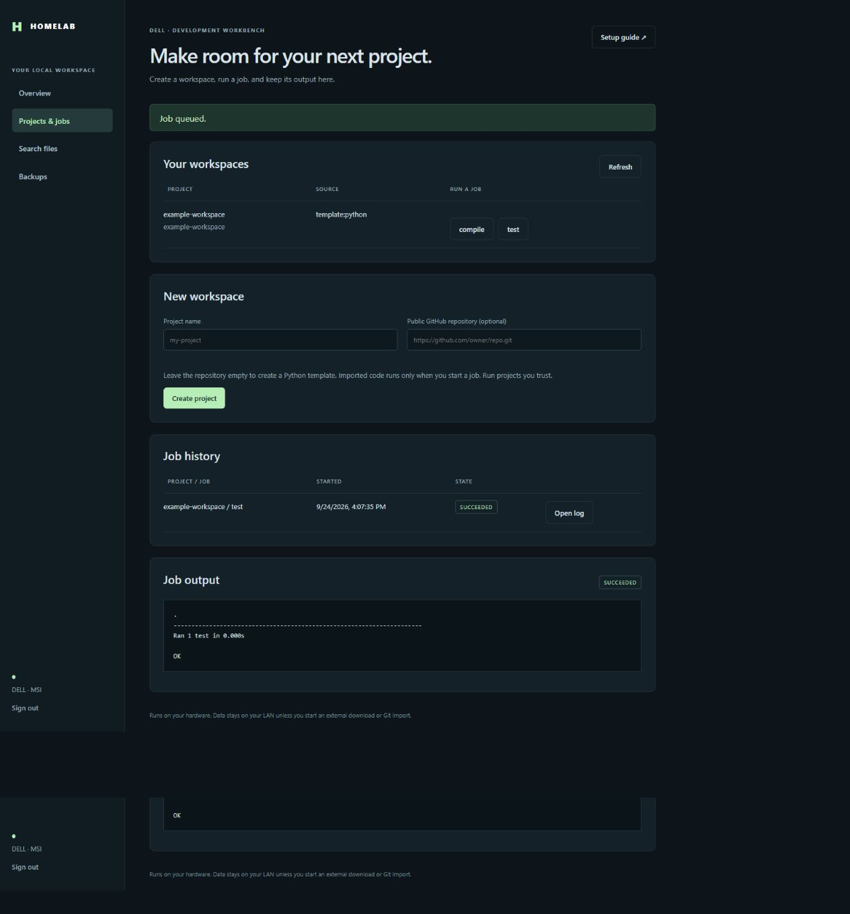
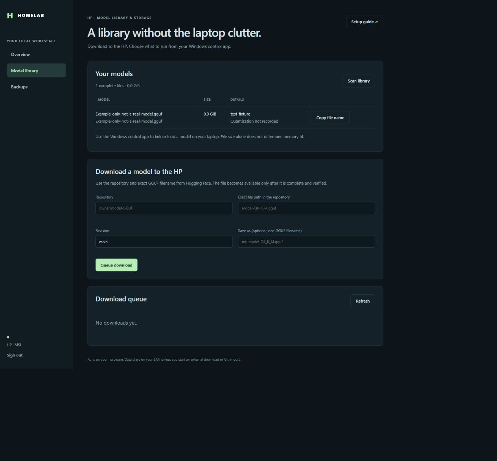

# Daily use

This page shows the things you will do every week. It assumes the [start guide](START-HERE.md) is finished.

> **Not yet proven on real hardware.** The web app has passed offline and local functional tests. Physical hardware verification is still pending. Button names below come from the app's source and may change a little.

## Your addresses

| What | Where |
| --- | --- |
| HP model library and backups | `http://HP_IP:8088/` |
| Dell projects, jobs, search and backups | `http://DELL_IP:8090/` |
| Server controls | `https://HP_IP:9090/` and `https://DELL_IP:9090/` (Cockpit) |
| Containers | `https://DELL_IP:9443/` (Portainer) |

Each server has its own login token. To show one again, run `sudo cat /etc/homelab/app-token` **on that server**. A login lasts eight hours.

If the Dell is off, its page says it is unavailable. That is normal. The HP stays on.

---

## Create a project

Use the **Dell** page.



*Local preview with sample project data; your Dell will show its own measurements and projects.*

1. Sign in at `http://DELL_IP:8090/`.
2. Click **Projects & jobs** in the left menu.
3. Under **New workspace**, type a **Project name**. Use lowercase letters, numbers and hyphens only. Example: `hello-lab`.
4. Leave **Public GitHub repository** empty. That makes a Python template.
5. Click **Create project**.

**You should see:** a message *Project created. Run its test job to check it.* Your project appears under **Your workspaces**, with two buttons: `test` and `compile`.

The template holds a small program (`app.py`), one real test (`tests/test_app.py`), a `README.md`, a `.gitignore` and a `pyproject.toml`. It lives in `/srv/homelab-projects/hello-lab` on the Dell.

**To import a project from GitHub instead**, paste a public address such as `https://github.com/OWNER/REPOSITORY`. Only public `https://github.com/` addresses work. The import has a 90 second limit. Projects with symbolic links are refused. Imported code runs only when you start a job. Run projects you trust.

## Run a test job and read the log

1. In **Your workspaces**, click **test** next to your project.

**You should see:** a message *Job queued.* and a **Job output** panel. The state badge goes from `queued` to `running` to `succeeded`. The panel refreshes on its own every few seconds.

For the template project the log shows the test result, like this:

```text
Ran 1 test in 0.001s

OK
```

2. To read it later, find the job under **Job history** and click **Open log**.
3. To stop a job, click **Cancel** while it is `queued` or `running`.

The states you may see are `queued`, `running`, `succeeded`, `failed`, `cancelled`, `timed_out` and `interrupted`. A restart marks a running job `interrupted`. Logs keep the last 128 KiB. A job stops after its time limit (15 minutes for `test` and `compile`).

The two presets are `test` (unit tests in the `tests` folder) and `compile` (Python syntax check). You cannot type your own command into the page. That is on purpose.

## Search your projects

The search index is not filled automatically. Build it first.

1. Click **Search files**.
2. Click **Rebuild search index**.

**You should see:** a message like *Indexed 5 files; skipped 0.*

3. Type words in **Words to find**. Pick a project, or leave it on **All projects**. Click **Search**.

**You should see:** a list of results, each with the project, the file path and a snippet. Click **Read file** to open one.

Rebuild the index after you edit or import files. Search only reads plain text files inside your projects. It skips secret files such as `.env` and keys, and folders such as `.git` and `node_modules`. Files over 256 KiB are not shown.

## Download a model

Use the **HP** page. The HP needs internet access for this.



*Local preview with a sample GGUF; your HP will show the models stored on its array.*

1. Sign in at `http://HP_IP:8088/`.
2. Click **Model library**.
3. Under **Download a model to the HP**, fill in:
   - **Repository**: the Hugging Face name, like `owner/model-GGUF`.
   - **Exact file path in the repository**: the `.gguf` file, like `model-Q4_K_M.gguf`.
   - **Revision**: leave `main` unless you know you need another.
   - **Save as** (optional): a new file name ending in `.gguf`.
4. Click **Queue download**.

**You should see:** *Download queued on the HP.* The **Download queue** shows a progress bar. The state goes `queued`, `resolving`, `downloading`, `validating`, then `completed`.

The model appears under **Your models** only after it is complete and checked. If it does not show, click **Scan library**. If a download fails, the reason is shown under the file name. Click **Cancel** to stop one.

The file is saved in the HP's `Models` share, so the laptop sees it at `\\HP_IP\Models`.

**File size does not tell you if a model fits in memory.** Check that before you load a big one.

To use the model, open **Homelab Control Center** on the laptop ([details](setup/WINDOWS.md)):

1. Click **Refresh model list**. Paste the HP token if asked.
2. Select the model. Click **Link selected model from NAS**. Approve the Windows prompt.
3. Click **Load selected model**. Confirm the question. Your existing local Switchboard does the loading.

The model stays on the HP and is read over the network. The desktop does not use these two buttons.

## Back up and restore

A backup is only real after you have restored from it once. Do the whole loop below the first time.

### Choose where backups go

- Use a **separate** disk mounted on the server, or use the **other server** over SFTP.
- A backup on the same RAID0 array does not protect you if the array fails. The tool refuses a destination on the same disk as the source.
- Pick folders you cannot download again: projects, notes, saves and exports.

### Set up a plan (one time)

The web page cannot create or edit plans. That is on purpose. A plan is made by an administrator on the server.

Example on the **Dell**, with a separate backup disk already mounted at `/mnt/backup`:

```bash
cd ~/homelab-stack
sudo bash services/configure-backup.sh \
  --id projects \
  --source /srv/homelab-projects \
  --mount /mnt/backup \
  --repository /mnt/backup/dell-projects
```

**You should see:** the plan is created and the path to a password file is printed. **Copy that password file somewhere safe, away from this server.** Without it you cannot restore.

To back up to the HP instead, follow **Back up to the other server over SSH** in the [backup guide](features/OPERATIONS.md). It has a few careful manual steps.

The script never erases, partitions, formats or mounts a disk.

### Run a backup

1. Open the server's page and click **Backups**.
2. Find your plan and click **Back up now**.

**You should see:** a **Backup output** panel. When it ends with the state `succeeded`, the backup finished. Before you make a plan, the page says *No backup plan configured*. Nothing is protected until a backup succeeds.

3. Click **Check**. This tests the stored data. It should also end `succeeded`.

### Restore

1. Click **Snapshots** next to the plan.
2. Pick a snapshot and click **Restore a copy**. Confirm the question.

**You should see:** the task ends `succeeded` and shows **Restored files:** with a folder under `/var/lib/homelab-app/restores/`.

A restore always goes to a **new** folder. It never overwrites your original files. Look inside on the server to check your files are there:

```bash
sudo ls /var/lib/homelab-app/restores/
```

After you have proved the backup and restore, schedule the named plan on that server:

```bash
sudo bash services/schedule-backup.sh projects daily
```

Use your actual plan ID in place of `projects`. Schedules are opt in. There is no automatic cleanup of old snapshots. See [schedules and retention](features/OPERATIONS.md#schedules-and-retention).

## Switch the Steam drive between PCs

Only one PC may use `S:` at a time.

1. On the PC that has it: close the game and Steam.
2. In **Homelab Control Center**, click **Release game drive**. Approve the Windows prompt. Wait for the command window to report success.
3. On the other PC, click **Attach game drive here**.
4. Not sure who has it? Click **Steam drive: status**.

The same three actions work from PowerShell. See the [game drive guide](GAME-DRIVE.md). If a PC crashed, **do not attach on the other PC yet**. Follow the recovery section in that guide.

## Update the software

On each server:

```bash
cd ~/homelab-stack
git pull --ff-only
sudo bash services/install.sh hp HP_IP DELL_IP     # on the HP
sudo bash services/install.sh dell DELL_IP HP_IP   # on the Dell
```

Run only the line for that machine. Your token and settings are kept. If the installer says `Existing apps.json differs`, an address or path has changed. Stop and check `/etc/homelab/apps.json`.

## If something goes wrong

| You see | What to do |
| --- | --- |
| A page will not open | Check the server is on. On the server run `sudo systemctl status homelab-app`. |
| *Incorrect login token* | You may have the other server's token. Run `sudo cat /etc/homelab/app-token` on that server. |
| *Wait one minute before trying again* | Too many wrong tokens. Wait, then try again. |
| A job says `failed` | Open its log. The last lines say why. |
| A search finds nothing | Click **Rebuild search index**, then search again. |
| A backup says *no backup plan* | Make a plan with `services/configure-backup.sh` first. |
| A download stays `failed` | Read the message under the file name. Check the HP has internet and the file name is exact. |

Back to the [start guide](START-HERE.md).
