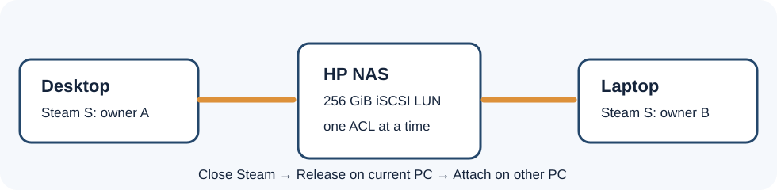

# Shared Steam `S:` drive

The HP hosts one 256 GiB iSCSI disk on its SSD. Windows sees it as a disk, so Steam can launch games directly from `S:`. **Only one PC may own it at a time.** The controller permits either the desktop or laptop initiator, and the scripts require a deliberate release before the other can attach.



## One-time setup

1. Finish HP NAS installation and both PC 10G links first. The target begins disabled.
2. On each PC, run `Prepare-Client.ps1` from [the main guide](INSTALL.md#10-set-up-the-exclusive-steam-drive). It prints that PC's initiator IQN, generates its own SSH public/private key pair, and writes its ignored local `game-client.json`.
3. Transfer each PC's **public** `.pub` file to the HP. Copy `hp/iscsi/controller.example.json` to ignored `hp/iscsi/controller.json` on HP and enter both real IQNs and the HP's 10G IP. Run `sudo bash hp/iscsi/install-controller.sh hp/iscsi/controller.json /path/to/desktop.pub /path/to/laptop.pub`.
4. Run the matching one-time SSH `status` command in [the main guide](INSTALL.md#10-set-up-the-exclusive-steam-drive) from each PC. Verify the HP host-key fingerprint through your HP console before accepting it. These accounts cannot open an interactive shell. Later script calls require strict checking.
5. On desktop, run `GameDrive.ps1 -Action Probe -ConfigPath .\client\game-drive\game-client.json` from elevated PowerShell. Check that **exactly one** new 256 GiB iSCSI disk appears. Record `UniqueId` and byte size. In Disk Management, initialize **only that disk** as GPT, create one NTFS volume, name it `SteamGames`, and assign `S:`. Copy the observed ID and byte size to `ExpectedDiskUniqueId` and `ExpectedSizeBytes` in both local client JSON files.
6. Add `S:\SteamLibrary` in desktop Steam. Close Steam, run `-Action Release`, then attach from the laptop and add the same path there. The laptop must **not initialize or format** the volume again.

## Every time you switch PCs

1. Close the game and Steam on the current PC.
2. From elevated PowerShell on that PC, run:

   ```powershell
   powershell -ExecutionPolicy Bypass -File .\client\game-drive\GameDrive.ps1 -Action Release -ConfigPath .\client\game-drive\game-client.json
   ```

3. Only after Release reports success, run this on the other PC:

   ```powershell
   powershell -ExecutionPolicy Bypass -File .\client\game-drive\GameDrive.ps1 -Action Attach -ConfigPath .\client\game-drive\game-client.json
   ```

Run `-Action Status` if you are unsure. Do not configure a persistent/favorite iSCSI reconnect in Windows. The example config requires a **10 Gbps** selected network link so a cable fault does not quietly move games to 1G.

## If a PC crashes or Release fails

Do **not** attach on the other PC yet. First make certain the old PC is powered off, its iSCSI session is gone, and it cannot automatically reconnect. On the HP console, check:

```bash
sudo python3 /usr/local/sbin/game-lun-controller.py status
sudo targetcli /iscsi/iqn.2026-09.local.homelab:steam-games/tpg1 ls
```

If state is `active` but the old PC is definitively offline and there are **zero** target sessions, the HP administrator can run `sudo python3 /usr/local/sbin/game-lun-controller.py release --host desktop --clean-client-offline` (or `--host laptop` for that owner). If the controller says a transition is incomplete, review the printed state and both client connections before using its guarded `recover-neutral --both-clients-offline` action. Never delete ACLs or enable the target manually to bypass a refusal. If a session is still present, determine which PC owns it and disconnect it there first.

The iSCSI target uses per-initiator IQN ACLs and a one-owner controller; CHAP is not configured. Keep its portal on the trusted LAN and do not forward TCP 3260 through the router. Use the game volume only for reinstallable games; Steam saves and launchers may still write to the PC's local disk.
