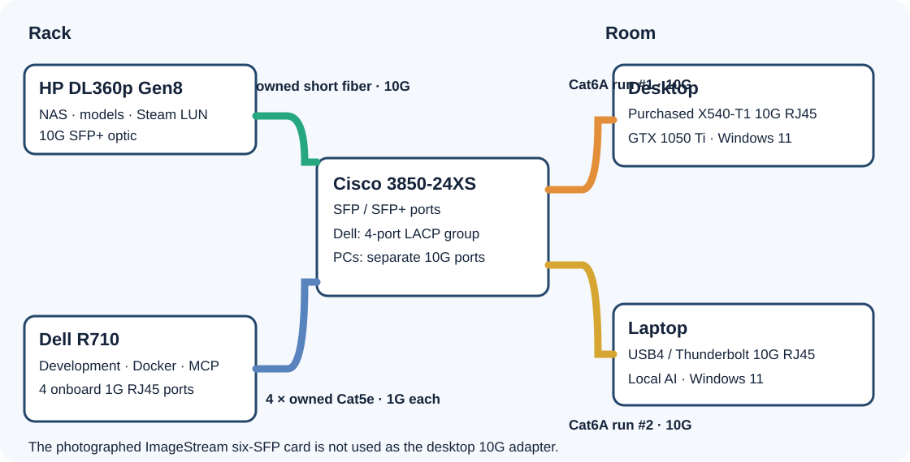
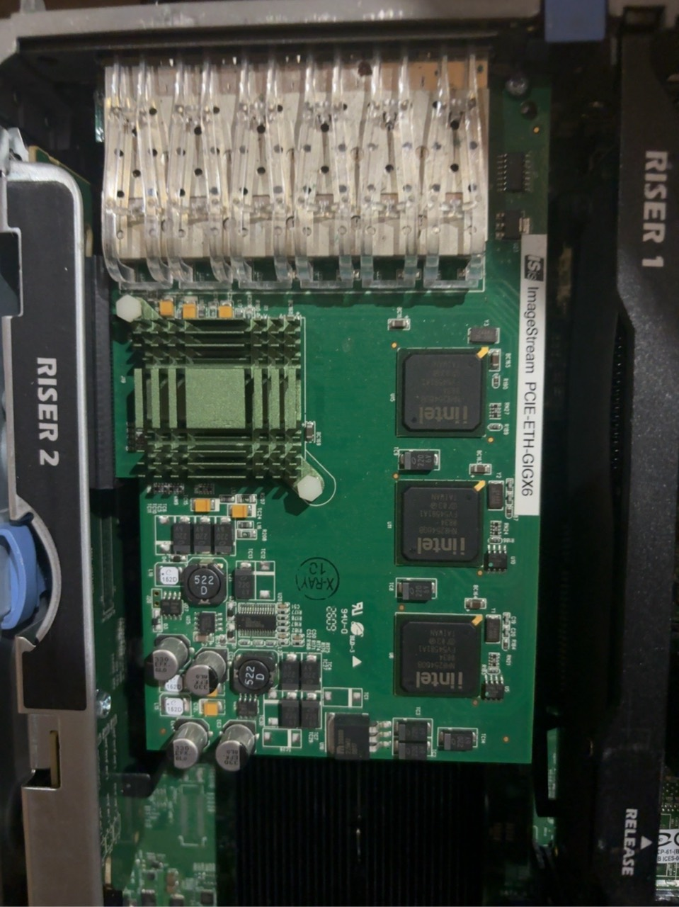
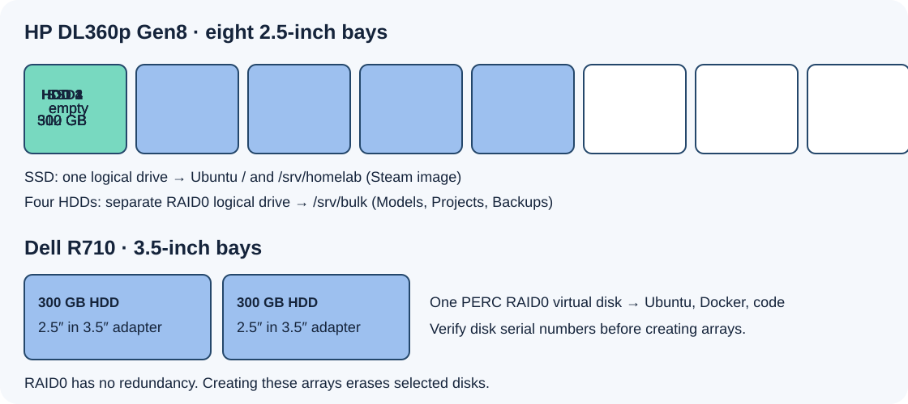

# Set up the homelab, one machine at a time

Follow this page from top to bottom. The pictures show the **planned** cabling and drive placement. Replace example IPs and Cisco port numbers with the values you see on your own equipment. The scripts install software after the operating systems and disk arrays exist.



## 1. Get the parts and check the distances

- Measure **two** separate rack-to-room cable paths with slack. Buy two pure-copper Cat6A cables of the measured lengths. Both PCs need their own cable. The whole route must be within the **10G reach of the copper SFP+ module at the Cisco end**. Cisco's SFP-10G-T-X example is rated for [30 m at 10G](https://www.cisco.com/c/en/us/products/collateral/interfaces-modules/transceiver-modules/data_sheet_c78-455693.html); a 100 ft cable is 30.48 m. Do not order a cable or module combination beyond its published rating.
- Buy a used **HPE 560FLR-SFP+** for the HP if it has the right FlexibleLOM slot and no suitable 10G card already installed.
- Buy a genuine used **Intel X540-T1 single-port 10G RJ45 PCIe x8 NIC** for the desktop's free x16 slot. Check that its bracket fits and its heatsink has airflow. The card in your photo, **ImageStream PCIE-ETH-GIGX6**, has six SFP cages and is **not** the assumed 10G desktop card. Its exact speed still needs a live hardware ID or link test; set it aside for this build.
- Buy a Windows-compatible **USB4/Thunderbolt 10GBASE-T RJ45 adapter** for the laptop. Keep the two existing Cisco copper 10G SFP+ modules, four 1G copper SFP modules for Dell, short HP fiber/optics, and four Dell Cat5e patch cables.
- Keep the complete delivered cart **under $300**. The [parts and budget](../docs/PARTS.md) show the current target. Do not buy CPU, RAM, another Dell NIC, a 40G module, or Pi hardware for this first deployment.

This is your photographed ImageStream card. It has **six SFP cages**, and its `PCIE-ETH-GIGX6` label does not establish 10 Gb/s operation. Keep it aside until a live PCI ID and link test establish its actual capabilities.



## 2. Make the Ubuntu installer USB

On an existing Windows PC, download these **two files manually**:

| File | Version | Source |
| --- | --- | --- |
| `ubuntu-24.04.5-live-server-amd64.iso` | Ubuntu Server 24.04.5 LTS amd64 | [Ubuntu release file](https://releases.ubuntu.com/24.04/ubuntu-24.04.5-live-server-amd64.iso) |
| `rufus-4.15p.exe` | Rufus 4.15 Portable | [Rufus official downloads](https://rufus.ie/downloads/) |

Check the ISO in PowerShell before writing it:

```powershell
(Get-FileHash .\ubuntu-24.04.5-live-server-amd64.iso -Algorithm SHA256).Hash.ToLower()
```

Expected hash: `97f3d7ffb032c3eb3b23d2c8be9cc76e60c2c1f2c0146ba5ba9fe01cafae0fd8`. Compare it with [Ubuntu's official SHA256SUMS](https://releases.ubuntu.com/24.04/SHA256SUMS). Use Rufus to write the ISO to the owned **64 GB USB stick**. Choose the USB carefully because Rufus erases it. Use **MBR / BIOS or UEFI-CSM** for these older servers. The same stick can install both servers. The stick is installer/recovery media; the HP boots from the SSD and the Dell from its HDD virtual disk.

## 3. Fit the drives and cables



Power both servers off. Write down each drive's serial number and verify any old data has been copied elsewhere. **Making a RAID0 logical drive erases the selected disks.** Fit the 512 GB SSD and four 300 GB 2.5-inch HDDs in the HP's 2.5-inch bays. Fit the remaining two 300 GB 2.5-inch HDDs in the Dell's 3.5-inch trays using the owned connector-aligning adapters.

At the HP Smart Array setup screen, make **two separate logical drives**: the SSD by itself, then the four HDDs together as RAID0. At the Dell PERC screen, make one RAID0 virtual disk from its two HDDs. Stop if the drive identities or sizes do not match. [HP front and rear reference](https://www.hpe.com/psnow/downloadDoc/HP%20ProLiant%20DL360p%20Generation%208%20%28Gen8%29-c04123167.pdf?deepLink=&form=false&hf=regular&id=c04123167.pdf&isFutureVersion=true&originalObjectName=&prelaunchSection=&preview=false&print=&r=&section=&softrollSection=&ver=2#page=1), [Dell R710 front and rear photos](https://i.dell.com/sites/doccontent/business/solutions/engineering-docs/en/Documents/server-poweredge-r710-tech-guidebook.pdf), and [Cisco 3850 front-panel reference](https://www.cisco.com/c/en/us/td/docs/switches/lan/catalyst3850/hardware/installation/guide/b_c3850_hig.pdf) help identify the physical parts.

Cable the **HP 10G optic** to the Cisco with matching owned SR/multimode or LR/single-mode parts. Cable the **Dell's four onboard RJ45 ports** to four separate Cisco 1G copper SFP ports using owned Cat5e. Cable the desktop's new RJ45 NIC and the laptop's RJ45 adapter to **different Cisco 10G copper-module ports**, each over its own Cat6A run.

## 4. Install Ubuntu on both servers

Boot the HP installer from USB (usually **F11** for a one-time boot menu). In custom storage, choose the **SSD logical drive** for the OS. Make boot partition(s) as the installer requires, then **64 GiB ext4 mounted at `/`** and the remaining SSD space **ext4 mounted at `/srv/homelab`**. Format the separate four-HDD logical drive as **ext4 mounted at `/srv/bulk`**. Select **OpenSSH server**. Keep the installer username and password.

Boot the Dell from the same USB stick (usually **F11** for its boot manager). Install Ubuntu on the **two-HDD PERC virtual disk**, with OpenSSH enabled. Its root filesystem holds Docker and active projects. If either installer shows the wrong logical-drive sizes, stop and inspect the controller setup.

After boot, check the HP mounts before running any scripts:

```bash
lsblk -f
findmnt /srv/homelab
findmnt /srv/bulk
```

Both HP mounts must be ext4 and listed in `/etc/fstab`. Keep an independent copy of unique files: both HDD arrays are RAID0, and GitHub only holds code you have pushed.

## 5. Give the machines stable LAN addresses

Reserve addresses in the router or assign deliberate static addresses. Record these values on paper or in a private local note:

| Item | Your value |
| --- | --- |
| Cisco LAN VLAN and unused host ports | `________` |
| HP 10G IP / Dell bond0 IP | `________ / ________` |
| Desktop 10G IP / laptop 10G IP | `________ / ________` |
| Dell's four real Ubuntu NIC names | `________ / ________ / ________ / ________` |

At the Cisco console, run the **read-only checks** at the top of [the switch candidate](../switch/candidate.txt). Identify the existing router uplink and management path, real VLAN and unused host ports. Replace **every** placeholder before applying the candidate host-port commands. Do not paste `LAN_VLAN` as written. The Dell's four switch ports must join one LACP EtherChannel. From the Dell **local console**, follow [the copper bond guide](DELL-NETWORK.md) to create `bond0`. It includes a backup and manual recovery procedure; changing the live LAN connection interrupts SSH.

Before installing HP services, confirm that the HP's optic is accepted and its NIC negotiates **10000Mb/s**. The HP deployment script will check this. On both Windows PCs, install the purchased adapters and check for a **10 Gbps** link on a short cable first. Use the vendor's Windows driver if Windows Update does not recognise the adapter. The [Intel Windows 11 driver page](https://www.intel.com/content/www/us/en/download/727998/intel-network-adapter-driver-for-microsoft-windows-11.html) is a starting point for a genuine Intel card; OEM-branded cards may need their OEM driver.

## 6. Clone this repo on each machine

The repository contains scripts, examples and diagrams. It contains no passwords, private keys, model weights, ISO image or driver binaries.

On each **Ubuntu server**, sign in as the ordinary Ubuntu user and run:

```bash
sudo apt-get update
sudo apt-get install -y git gh
gh auth login
gh repo clone Noxy-HNR/homelab-stack
cd homelab-stack
```

For a public repo, you may replace the `gh` login and clone with `git clone https://github.com/Noxy-HNR/homelab-stack.git`. On each **Windows PC**, install Git and GitHub CLI once if missing, then clone:

```powershell
winget install --id Git.Git --exact
winget install --id GitHub.cli --exact
gh auth login
gh repo clone Noxy-HNR/homelab-stack
Set-Location .\homelab-stack
```

Restart the Windows terminal if it does not yet find `gh` or `git`. Authenticate on each machine if the repo is private. Run the installers **from the clone** so their nearby support files are present. Use `git pull --ff-only` in the clone for later updates; do not commit the local client JSON or keys.

## 7. Install the HP software

From the HP clone, replace both example addresses. The **first address must already be on the HP's 10G interface**:

```bash
sudo bash hp/deploy.sh plan 192.168.1.10 192.168.1.20
sudo bash hp/deploy.sh install 192.168.1.10 192.168.1.20
sudo bash hp/deploy.sh verify 192.168.1.10 192.168.1.20
```

The `plan` shows the mounted storage and intended changes. `install` checks the live 10G link, installs Samba and LIO, fully allocates the 256 GiB game image, asks you to set the Samba password, then installs Cockpit and the LAN dashboard. Leave the Steam target disabled until step 10. Open `http://HP-IP:8088/` from a PC to see the dashboard.

## 8. Install the Dell software

Finish the four-port bond first. From the Dell clone, replace the example address with the real IP on `bond0`:

```bash
sudo bash dell/deploy.sh plan 192.168.1.20
sudo bash dell/deploy.sh install 192.168.1.20
sudo bash dell/deploy.sh verify 192.168.1.20
```

The installer checks all four 1G bond members, installs development tools and Docker, builds a small MCP demo, and starts Cockpit and Portainer. Use `https://DELL-IP:9090/` for Cockpit and `https://DELL-IP:9443/` for Portainer. From the laptop, reach the Dell MCP demo through a local SSH tunnel:

```powershell
ssh -N -L 8765:127.0.0.1:8765 YOUR_DELL_USER@DELL-IP
```

Then configure an MCP client for `http://127.0.0.1:8765/mcp`. Your existing laptop Switchboard stays local and is not replaced.

## 9. Set up the Windows PCs and model library

From **elevated PowerShell** in the desktop clone:

```powershell
powershell -ExecutionPolicy Bypass -File .\desktop\install.ps1 -Action Plan
powershell -ExecutionPolicy Bypass -File .\desktop\install.ps1 -Action Install
# Reboot or finish the first WSL, Docker Desktop and Ollama launch if requested.
powershell -ExecutionPolicy Bypass -File .\desktop\install.ps1 -Action PullModel
powershell -ExecutionPolicy Bypass -File .\desktop\install.ps1 -Action Verify
```

From PowerShell in the laptop clone:

```powershell
powershell -ExecutionPolicy Bypass -File .\laptop\install.ps1 -Action Plan
powershell -ExecutionPolicy Bypass -File .\laptop\install.ps1 -Action InstallTools
powershell -ExecutionPolicy Bypass -File .\laptop\install.ps1 -Action Verify
```

On the laptop, open `\\HP-IP\Models` in Explorer and sign in as `homelabshare` with the password from step 7. Put **single-file GGUF models** in that share. List available models and register only the ones you want visible to the existing local stack:

```powershell
powershell -ExecutionPolicy Bypass -File .\laptop\NetworkModels.ps1 -Action Plan -Share '\\192.168.1.10\Models'
powershell -ExecutionPolicy Bypass -File .\laptop\NetworkModels.ps1 -Action Register -Share '\\192.168.1.10\Models' -Names 'your-model.gguf'
```

The registered link uses negligible laptop disk space. The model data is read from HP over SMB when selected; inference runs on the laptop. Keep the lightweight existing model locally for when HP is off or unavailable.

## 10. Set up the exclusive Steam drive

This is the one part that needs real values from **both PCs**. Do it after their 10G links and the HP NAS are working.

On each Windows PC, from its repo clone in **elevated PowerShell**, run `Prepare-Client.ps1` with that PC's role and 10G source IP. Example on the desktop:

```powershell
powershell -ExecutionPolicy Bypass -File .\client\game-drive\Prepare-Client.ps1 -HostRole desktop -HpIp 192.168.1.10 -LocalIp 192.168.1.30
```

Repeat on the laptop with `-HostRole laptop` and the laptop's own 10G IP. The helper creates a **different SSH key on each PC**, a local ignored `game-client.json`, and prints each Windows iSCSI initiator IQN. Copy the **two public `.pub` files only** to the HP. On the HP, copy `hp/iscsi/controller.example.json` to `hp/iscsi/controller.json`, then fill in the two printed IQNs and HP 10G IP. Do not commit that file. Run:

```bash
sudo bash hp/iscsi/install-controller.sh hp/iscsi/controller.json /path/to/desktop.pub /path/to/laptop.pub
```

The installer creates separate `gamehandoff-desktop` and `gamehandoff-laptop` SSH accounts. Each key can claim or release only its own host. From each PC, run its matching command below, replacing `HP-IP` with the real HP address. Compare the SSH host-key fingerprint shown on the PC with the HP console (`ssh-keygen -lf /etc/ssh/ssh_host_ed25519_key.pub`) before accepting it. These restricted accounts cannot open an interactive shell. `GameDrive.ps1` then uses strict host-key checking. The controller intentionally uses iSCSI IQN ACLs without CHAP on the LAN, and the target is enabled for only one PC at a time.

```powershell
# Desktop only:
ssh -i "$env:USERPROFILE\.ssh\homelab_game_desktop" gamehandoff-desktop@HP-IP 'sudo -n /usr/bin/python3 /usr/local/sbin/game-lun-controller.py status'
# Laptop only:
ssh -i "$env:USERPROFILE\.ssh\homelab_game_laptop" gamehandoff-laptop@HP-IP 'sudo -n /usr/bin/python3 /usr/local/sbin/game-lun-controller.py status'
```

On the **desktop first**, run `GameDrive.ps1 -Action Probe -ConfigPath .\client\game-drive\game-client.json` in elevated PowerShell. Read the output: check the new disk is exactly the **256 GiB iSCSI** disk and record its `UniqueId` and byte size. Only then use Windows Disk Management to initialize **that disk** as GPT, make one NTFS volume named `SteamGames`, and assign `S:`. Add `S:\SteamLibrary` in Steam. Enter the observed `ExpectedDiskUniqueId` and `ExpectedSizeBytes` in both PCs' local `game-client.json`. Do not initialize the disk again on the laptop.

Close Steam and games, then release the drive from the desktop:

```powershell
powershell -ExecutionPolicy Bypass -File .\client\game-drive\GameDrive.ps1 -Action Release -ConfigPath .\client\game-drive\game-client.json
```

On the laptop, run `-Action Attach` with its own local config. Release it before returning to the desktop. **Never enable Windows iSCSI persistent or favorite-target reconnect** for this volume. Use `-Action Status` when unsure who owns it. The [detailed handoff guide](GAME-DRIVE.md) covers a failed release or a crash.

## 11. Verify the finished build

- HP and both PC links show **10 Gb/s**. The HP's two ext4 mounts and shares remain available after a reboot. The HP dashboard works even when the Dell is off.
- Cisco and Dell show **four bundled 1 Gb/s LACP members**. Dell SSH, Docker Compose, MCP demo, Cockpit and Portainer work after a reboot.
- The laptop opens `\\HP-IP\Models` and loads one linked GGUF from the HP while its own inference process runs. Its existing local model still works with the HP disconnected.
- A small Steam game launches from `S:` on the desktop, then from `S:` on the laptop **after a successful release**. Each PC sees the same library, never concurrently.

The [validation record](VALIDATION.md) says what has been checked offline and what still needs to be proven on the actual hardware.
