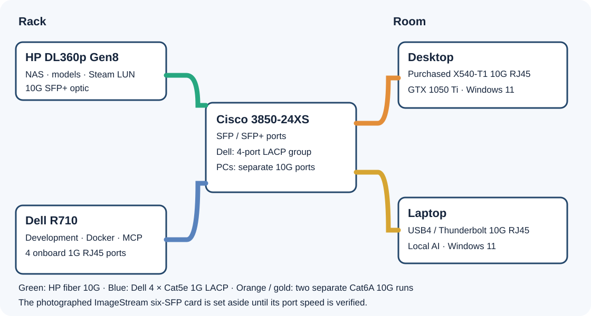

# Start here

This guide gets you from a pile of parts to a working homelab. Do the steps in order. Do not skip ahead.

> **Status: not yet proven on real hardware.** The scripts and docs have passed **offline and local functional tests**. **Physical hardware verification is still pending.** If a step fails, stop. Do not work around it. Write down what you saw. See [validation status](VALIDATION.md).



The picture shows the **planned** cabling. Your IP addresses and switch port numbers will differ.

## What you will build

| Machine | Job | Web page it gets |
| --- | --- | --- |
| **HP** | Always-on storage. Model library and Steam drive. | `http://HP-IP:8088/` |
| **Dell** | Development workbench. Projects, jobs, search, Docker. | `http://DELL-IP:8090/` |
| **Desktop** | Games and AI work. | Windows control app |
| **Laptop** | Everyday PC. Runs AI models from the HP library. | Windows control app |

Each server has its own login token. The installer prints it for you.

## The plan in six parts

1. **Part 1.** Buy parts, make the USB, fit drives and cables.
2. **Part 2.** Install Ubuntu on the HP and the Dell.
3. **Part 3.** Set up the HP.
4. **Part 4.** Set up the Dell.
5. **Part 5.** Set up the Windows PCs.
6. **Part 6.** Set up the Steam drive. Then check everything.

You need: the parts, one 64 GB USB stick, a monitor and keyboard for the servers, and a Windows PC with internet.

---

## Part 1. Parts, USB and cables

Use the existing steps in the [detailed install guide](INSTALL.md). They cover the physical work and the operating system.

### 1. Get the parts and check cable distances

Follow [INSTALL.md step 1](INSTALL.md#1-get-the-parts-and-check-the-distances). Do not buy anything beyond the published range of your cables and modules.

### 2. Make the Ubuntu USB

Follow [INSTALL.md step 2](INSTALL.md#2-make-the-ubuntu-installer-usb). Download these **two files by hand**:

| File | Version | Source |
| --- | --- | --- |
| `ubuntu-24.04.5-live-server-amd64.iso` | Ubuntu Server 24.04.5 LTS amd64 | [Ubuntu release file](https://releases.ubuntu.com/24.04/ubuntu-24.04.5-live-server-amd64.iso) |
| `rufus-4.15p.exe` | Rufus 4.15 Portable | [Rufus official downloads](https://rufus.ie/downloads/) |

Check the ISO before you write it. The expected SHA256 hash is `97f3d7ffb032c3eb3b23d2c8be9cc76e60c2c1f2c0146ba5ba9fe01cafae0fd8`. The exact command is in INSTALL.md step 2.

### 3. Fit the drives and cables

Follow [INSTALL.md step 3](INSTALL.md#3-fit-the-drives-and-cables). **Making a RAID0 drive erases the disks you choose.** Check first that nothing you need is on them.


Your photographed network card is a six-port ImageStream. It is **not** the assumed 10G card. Set it aside until a live test shows what it can do.


**You are done with Part 1 when:** both servers are fitted with drives, cabled to the switch, and powered off.

## Part 2. Install Ubuntu on both servers

1. Follow [INSTALL.md step 4](INSTALL.md#4-install-ubuntu-on-both-servers). Pick **OpenSSH server** on both machines.
2. Follow [INSTALL.md step 5](INSTALL.md#5-give-the-machines-stable-lan-addresses). Give every machine a fixed address. Write the addresses down. You will type them many times.
3. Follow [INSTALL.md step 6](INSTALL.md#6-clone-this-repo-on-each-machine). This puts a copy of this repo on each machine.

**Expected on the HP:** `findmnt /srv/homelab` and `findmnt /srv/bulk` each show an `ext4` line.

**You are done with Part 2 when:** you can SSH to both servers, the HP has its two mounts, and the Dell has its four-port network bond (see the [Dell network guide](DELL-NETWORK.md)).

Steps 7, 8 and 9 of the detailed guide link to the same machine pages used below.

## Part 3. Set up the HP

Follow **[HP setup](setup/HP.md)**. In short, on the HP you run:

```bash
sudo bash hp/deploy.sh install HP_IP DELL_IP
```

**Expected at the end:** a line that says `Open http://HP_IP:8088/`, then a long login token. Save the token somewhere private.

## Part 4. Set up the Dell

Follow **[Dell setup](setup/DELL.md)**. In short, on the Dell you run:

```bash
sudo bash dell/deploy.sh install DELL_IP HP_IP
```

**Expected at the end:** a line that says `Open http://DELL_IP:8090/`, then a login token. It is a **different** token from the HP.

## Part 5. Set up the Windows PCs

Follow **[Windows setup](setup/WINDOWS.md)**. It installs the tools on each PC and the Windows control app.

## Part 6. Set up the Steam drive, then check everything

1. Follow [INSTALL.md step 10](INSTALL.md#10-set-up-the-exclusive-steam-drive). It is the one-time first-use guide. The [game drive guide](GAME-DRIVE.md) explains crashes and recovery.
2. Check the whole build with the list below.

### Final checklist

- [ ] HP and both PCs show a **10 Gb/s** link.
- [ ] `http://HP-IP:8088/` opens and your HP token signs you in.
- [ ] `http://DELL-IP:8090/` opens and your Dell token signs you in.
- [ ] The Dell shows four bundled 1 Gb/s network members.
- [ ] The laptop can open `\\HP-IP\Models`.
- [ ] A small Steam game starts from `S:` on the desktop. After a release, it starts from `S:` on the laptop.

Something wrong? Each setup page has a **If something goes wrong** section.

## Now what?

Read **[Daily use](DAILY-USE.md)**. It shows how to create a project, run a test, search files, download a model, and back up and restore.

## Upgrade later

On each server, from your clone of this repo:

```bash
git pull --ff-only
sudo bash services/install.sh hp HP_IP DELL_IP     # on the HP
sudo bash services/install.sh dell DELL_IP HP_IP   # on the Dell
```

Run only the line for that machine. On Windows, pull the same way, then see [Windows setup](setup/WINDOWS.md).
